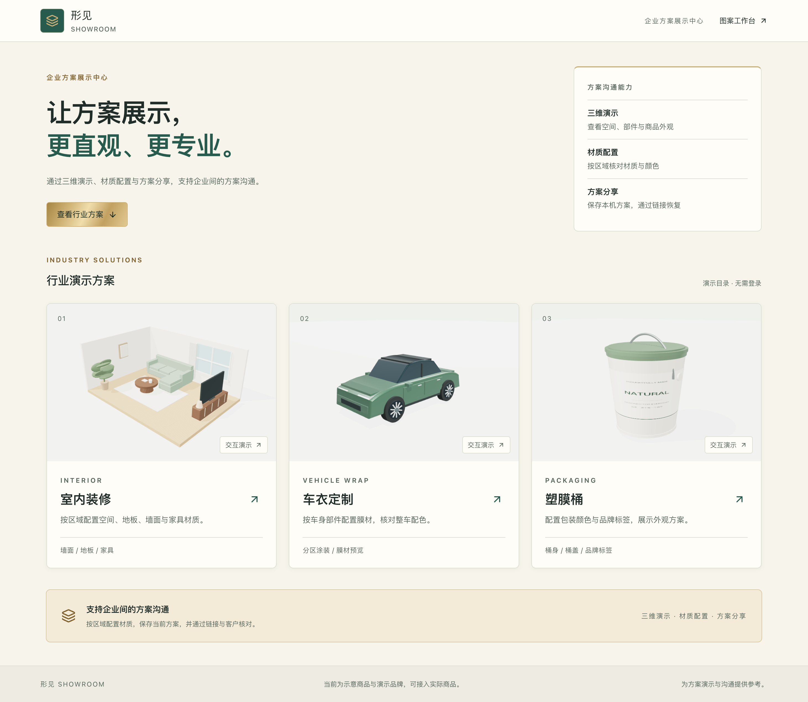

# 形见 · Xingjian Showroom

**让方案展示，更直观、更专业。**

[](LICENSE)
[](https://github.com/scottzx/xingjian-showroom/releases/latest)
[](https://github.com/scottzx/xingjian-showroom/actions/workflows/pages.yml)

一个基于 React、TypeScript 和 Three.js 的多行业三维方案展示应用。支持查看商品与空间、按区域配置材质，并通过链接与客户核对方案。

**[在线演示](https://scottzx.github.io/xingjian-showroom/) · [下载最新版本](https://github.com/scottzx/xingjian-showroom/releases/latest) · [English](#english)**



## 可以做什么

| 场景 | 交互能力 |
| --- | --- |
| C108 · 108 方户型 | 空间与水电三维展示、图纸对照、材质配置、GLB 下载 |
| 客厅空间 | 配置地板、墙面、沙发与柜体，切换俯视与墙体显隐 |
| 通用车身 | 按车身、机盖、车顶、车门、保险杠换色，一键应用整车 |
| 包装桶 | 配置桶身、桶盖与标签，实时更新品牌文字 |
| 施工场地 | 六设施足迹定位、原 CAD 二维对照、来源与暂定尺寸说明 |
| IFG · 两层教学楼 | 分层查看、图纸对照、开口几何及 GLB 下载 |

六个场景均可从首页直接进入，无需登录或配置数据库。支持旋转缩放、选区高亮、材质配置、方案分享与导出。另附二维图案工作台及原创通用示意模板。

三组程序化模型与三组获维护者公开确认的 CAD 派生示例一并分发。施工场地比例暂定、实际高度未知；IFG 源资料完整性仍需返工；C108 未经现场核验。模型用于方案沟通，不作为施工、生产或安全判断依据。素材范围与来源见 [素材说明](docs/model-assets.md)。

## 本地运行

需要 **Node.js 22.18+**，推荐 Node.js 22 LTS。

```sh
git clone https://github.com/scottzx/xingjian-showroom.git
cd xingjian-showroom
npm ci
npm run dev
```

打开终端打印的地址。常用命令：

```sh
npm test          # 目录、方案、模型结构及几何核对逻辑测试
npm run build    # TypeScript 检查与生产构建
npm run preview  # 预览 dist/ 中的生产构建
```

无需 Git 子模块或私有服务。`.env.example` 仅用于可选的 Supabase 登录/图库接入；公开演示不需要填写。

## 部署与下载

推送到 `main` 后，GitHub Actions 自动安装依赖、运行测试、构建并发布到 GitHub Pages。应用采用 HashRouter，可直接刷新和分享方案链接。

自行部署到子目录时运行：

```sh
npm run build -- --base /your-project/
```

将 `dist/` 放到静态 HTTP 服务。Release 附件中的 `xingjian-showroom-v0.2.0-web.zip` 是构建好的静态站点；解压后可使用任意静态服务器打开。源码归档由 GitHub 自动提供，附件 `SHA256SUMS.txt` 可用于校验下载。

## 扩展模型与客户

- [商品、客户与材质目录](src/catalog/catalog.ts)：配置可选区域、材质及行业入口。
- [模型注册表](src/scenarios/registry.ts)：程序化模型、GLB 与 CAD 数据适配。
- [共享渲染器](src/viewer/runtime.ts)：相机、选择、材质、导出及资源释放。
- [品牌配色](src/styles/brand.css)：一芥智能的墨绿、米白、香槟老金与深墨。
- [架构与数据边界](docs/architecture.md)：公开版内容、授权模型接入及限制。

源码与静态包均包含这六个场景需要的派生 JSON/GLB 和二维对照，原始 DWG/DXF 与内部工作记录不随包分发。部署子目录时，模型和下载链接统一通过 `publicAssetUrl` 解析。

## 开源协议与致谢

软件采用 [MIT License](LICENSE)。二维编辑器基于 [Tesla Wrap Studio](https://github.com/dtschannen/Tesla-Wrap-Studio) 改造，感谢 dtschannen 及其贡献者；依赖和素材的许可范围见 [Third-party notices](THIRD_PARTY_NOTICES.md)。

## English

Xingjian Showroom is a React + TypeScript + Three.js application for interactive product and space presentations. Configure materials by part, compare designs, export images and share plans through a URL. The public edition includes six scenes: C108 apartment, procedural living room, generic vehicle, packaging bucket, teaching construction site and IFG two-storey classroom. A generic two-dimensional editor template is also included.

Run `npm ci && npm run dev` with Node.js 22.18 or newer. Run `npm test` and `npm run build` before deployment. No account, database or private submodule is needed for the public demonstrations. Approved derived CAD examples are bundled with provenance and unresolved limitations; raw DWG/DXF files and private work history are excluded. The software is released under MIT; third-party asset rights remain separate. See the asset notes and attribution above.
